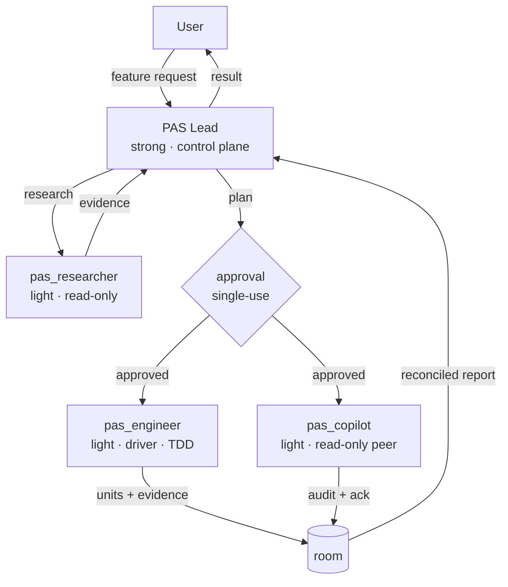

# ✦ Pulsar Agent Squad (PAS)

A lightweight harness for everyday software development.

From new features to ongoing maintenance, PAS coordinates agents to keep work
moving—fast, bounded, and verified.

## From Nova to Pulsar

[Nova Agent Squad](https://github.com/GabrielMartinMoran/nova-agent-squad)
established a multi-platform foundation for explicitly authorized,
contract-driven agent work. Pulsar Agent Squad carries those principles into a
leaner, more atomic workflow: less process overhead, while keeping work
bounded, approved, and verified.

PAS also adds durable project context—living documentation, decision records,
and resumable memory—so agents can support ongoing development and long term maintenance.

## Why PAS

PAS runs a serious engineering workflow without paying for a strong model in
every role. Five properties keep it honest:

- **Strong where it matters.** One strong model runs the control plane:
  planning, approval, and adjudication. Research, implementation, and
  verification run on light workers.
- **Single-use approval gates.** No source change starts without your explicit
  approval, scoped to the task at hand; approval never authorizes later scope
  expansion.
- **Closed contracts and a copiloted pair.** Each delegation names its scope,
  exact paths, and assigned skills. A light engineer writes, a read-only copilot
  re-executes the checks and returns one `PASS`, `FAIL`, or `BLOCKED` verdict,
  and the Lead adjudicates the reconciled report.
- **Numbered, single-writer state.** Features live in `.pas/state/NNNNN-slug/`;
  lifecycle operations go through the installed `pas_toolkit` plugin (`list`,
  `check`, `new`, `archive`), and conflicts block instead of guessing.
- **Living docs and resumable memory.** `docs/` is a map with an ADR trail, and
  Mind checkpoints let a session resume where it stopped.

## Install

You need a POSIX shell, `git`, and [`bun`](https://bun.sh) on your `PATH`. PAS
does not auto-install bun.

```bash
git clone https://github.com/GabrielMartinMoran/pulsar-agent-squad.git
cd pulsar-agent-squad
./install.sh          # default target: opencode
```

`./install.sh` delegates to `pas install --target=opencode`, so the bootstrap
and the CLI share one code path. Other targets use the same flag:

```bash
./install.sh --target=cursor
```

OpenCode is the primary runtime; the full target list is
[`config/platforms.manifest`](config/platforms.manifest).

## Quick start

Verify the install, then point OpenCode at the Lead:

```bash
./pas doctor          # prerequisites, the manifest, and source routes
./pas validate        # agent frontmatter and structure
```

Set `default_agent` in `~/.config/opencode/opencode.json` so the Lead is the
first agent you talk to:

```json
{
  "default_agent": "Pulsar Agent Squad"
}
```

PAS does not set `default_agent` for you. Run `./pas --help` for the full
command surface.

### Initialize PAS in a project

When `.pas/pas.config.yaml` is absent from the **project workspace**, the
Lead or Pulsar Agent Turbo can preview a generic configuration using the
installed `pas_toolkit` operation `init`. The agent shows the configuration
and asks for approval before invoking it with `confirm: true`. It creates
only `.pas/pas.config.yaml`, derives the project slug from the workspace
directory (or accepts an explicit slug), and **never overwrites** an existing
file. The agent then performs the ordinary PAS state checks. No checkout of
this harness repo is required.

The generic, reviewable example is
[`src/templates/pas.config.example.yaml`](src/templates/pas.config.example.yaml).
The file [`.pas/pas.config.yaml`](.pas/pas.config.yaml) belongs to the
PAS harness **itself** and is not the reusable template. Review the generated
`product`, `mind_spaces`, memory settings, and Gherkin policy for your project.
Mind is optional (`memory.required: false` in the example).

## Pulsar Agent Turbo (alternative OpenCode mode)

**Pulsar Agent Turbo** is an optional, more autonomous primary agent. It uses the
same PAS approval gates, numbered feature state, tagged Gherkin, skills,
checkpoints, TDD, and final verification, but it handles routine research,
implementation, and QA directly. It delegates only when scope, risk,
independent review, or remaining context warrants it.

Turbo reuses `pas_researcher`, `pas_engineer`, and `pas_copilot` as **optional
background-capable workers**. Delegated implementation uses the copiloted pair,
one unit at a time; the engineer and read-only copilot may run concurrently
because only one of them writes. For higher-risk changes, Turbo requests the
independent copilot even when it wrote the code itself. The final report
distinguishes `SELF` from `INDEPENDENT` verification.

**Same engineering rigor, less coordination overhead:** when working alone,
Turbo batches independent reads and runs non-conflicting checks in parallel.
It writes failing tests first, iterates with **focused tests** through
Red → Green → Refactor, and runs the **full project suite** before QA—not
after every small edit. Self-QA still reviews the real diff, scenario and
edge-case coverage, test-level choices and pyramid health, lint, and read-only
format validation. Missing or failing required checks cannot become a PASS.

To try Turbo without replacing the standard Lead:

```bash
./pas build --target=opencode
./pas install --target=opencode
./pas agents setup              # asks which tool to configure (OpenCode or Pi)
```

`pas agents setup` asks which tool to configure and defaults to OpenCode. Pass
`--target=<id>` to skip that prompt; an id without a setup adapter exits
non-zero before reading or writing any configuration. Only OpenCode and Pi have
setup adapters, even though the manifest declares more install targets.

Choose **Pulsar Agent Turbo** in OpenCode's agent selector, or set
`"default_agent": "Pulsar Agent Turbo"` in your OpenCode config. Switch back to
`"Pulsar Agent Squad"` at any time. The existing PAS Lead and workers are
unchanged; Turbo is an additional installed agent, not a global mode switch.

**Runtime compatibility:** OpenCode 2 calls its background worker tool
`subagent` and translates supported V1 agent frontmatter. Older OpenCode
calls it `task` and may require an experimental background-subagents flag.
Turbo falls back to sequential foreground dispatch if background dispatch
is unavailable; test on your installed version. The current PAS toolkit plugin
has not been ported or verified against OpenCode 2's changed plugin API, so
a V2 end-to-end run (including state lifecycle) is not yet certified.

Sources: [Turbo agent](src/agents/Pulsar%20Agent%20Turbo.md),
[behavior contract](specs/features/product/turbo-mode.feature),
[ADR](docs/adr/0005-optional-autonomous-turbo-lead.md).

## Pi target (alternative runtime)

Pi is a supported second runtime target
([ADR 0006](docs/adr/0006-pi-runtime-target.md)). PAS ships native Pi subagents
and skills rather than transforming the OpenCode prompts. Pi 1.2.0 or newer is
required for `pi-subagents`.

```bash
./pas build --target=pi
./pas install --target=pi            # always installs the configured plugins
./pas install --target=pi --dry-run  # print destinations and commands only
./pas uninstall --target=pi          # remove only files PAS installed
```

Installation preflights the `pi` binary, copies agents, skills, settings, and
the toolkit extension under `~/.pi/agent`, then installs every source in
[`config/pi-packages.txt`](config/pi-packages.txt) with `pi install`. Sources
already configured per `pi list` are skipped, and the first failure aborts
non-zero. There is no `--with-plugins` flag: plugin installation is the default
for this target. Uninstall removes only files whose basenames exist in the
source trees, so unrelated files in the same directory survive.

Start the workflow with `/skill:pas-lead` (control plane) or `/skill:pas-turbo`
(autonomous primary). Both skills set `disable-model-invocation: true`, so they
load only when invoked.

To configure models, run the setup wizard from the checked-out repo:

```bash
./pas agents setup --target=pi
```

Pi 1.2.0 or newer is required for `pi-subagents`. The wizard runs these steps:

1. Preflights the `pi` binary. If PAS's Pi artifacts are missing, it warns and
   points to `pas install --target=pi`; it does not install them.
2. Compares [`config/pi-packages.txt`](config/pi-packages.txt) with `pi list`
   and offers to install missing packages once. It never removes packages. When
   Pi is older than 1.2.0, `pi-subagents` is skipped with a warning and the other
   missing packages still install.
3. Re-reads `~/.pi/agent/settings.json` after any install, then asks which
   subagent to configure. The Pi target keeps its own roster — `pas_researcher`,
   `pas_developer`, and `pas_qa` — because Pi intentionally does not ship the
   OpenCode copiloted pair. Only those three are offered: the Pi leads are
   skills, not subagents.
4. Discovers models with `pi --list-models` and falls back to manual model-id
   entry when the table yields no models.
5. Offers a thinking level (`off`, `minimal`, `low`, `medium`, `high`, `xhigh`,
   `max`) only when the chosen model reports thinking support.
6. Writes `subagents.agentOverrides.<agent>` with `model`, `defaultProvider`,
   and optional `thinking` in `~/.pi/agent/settings.json`. Unknown keys are
   preserved, and the previous file is backed up as
   `<path>.bak.<YYYYMMDDHHMMSS>` only when the content changes.
7. Prints `Run /reload in Pi for changes to take effect.`

Setup writes user scope only (`~/.pi/agent/settings.json`); it never writes a
project `.pi/settings.json`.

Workers inherit the parent model by default. The installed
`pas-settings.snippet.json` remains a reference for manual tiering, while
`pas agents setup --target=pi` writes the real settings for you. The snippet
below names the **Pi roster** (`pas_developer` and `pas_qa`; OpenCode ships the
copiloted pair instead), and placeholder model IDs must exist in your Pi
installation:

```json
{
  "subagents": {
    "defaultModel": "<model-id>",
    "agentOverrides": {
      "pas_researcher": { "model": "<model-id>" },
      "pas_developer": { "model": "<model-id>" },
      "pas_qa": { "model": "<model-id>" }
    }
  }
}
```

Model precedence, strongest first: per-run > provider-scoped role >
`agentOverrides.<name>.model` > agent frontmatter model >
`subagents.defaultModel` > parent session model. Run `/subagents-models` to see
the live mapping. Reinstalling PAS backs up an edited installed snippet as
`~/.pi/agent/pas-settings.snippet.json.bak` before overwriting it; that backup
protects the snippet, not `~/.pi/agent/settings.json`. The source and dist file
is `settings.snippet.json`; the installed copy is `pas-settings.snippet.json`.

Pi offers tool allowlists but no path-scoped denies. The Lead's read-only
boundary and the Pi developer's prohibition on editing `.pas/**` and
`specs/**/*.feature` are contractual, enforced by prompt and audited by the Pi
QA agent. On OpenCode, the same boundaries are runtime denials.

Sources: [behavior contract](specs/features/product/pi-runtime-target.feature),
[ADR](docs/adr/0006-pi-runtime-target.md), [agent sources](src/agents/pi/),
[skill sources](src/skills/pi/).

## How it works

Describe a feature; the Lead takes it from there:

1. **Describe** — the Lead clarifies scope and critical assumptions.
2. **Research** — `pas_researcher` gathers evidence; independent questions run
   as one background batch.
3. **Plan** — the Lead writes the plan, tagged Gherkin, and task contracts,
   then stops at the approval boundary.
4. **Approve** — you approve once, scoped to the plan. A changed plan needs a
   new approval.
5. **Implement** — one delegation spawns the pair. `pas_engineer` executes one
   unit (one acceptance scenario) at a time with TDD and self-verifies each
   unit.
6. **Audit** — `pas_copilot` re-executes the checks read-only, audits the code
   and process, and returns the terminal ack; the Lead adjudicates the
   reconciled report and reports.



| Agent            | Model  | Role                                                  | Source                                                                     |
| ---------------- | ------ | ----------------------------------------------------- | -------------------------------------------------------------------------- |
| PAS Lead         | strong | Original delegated control plane                     | [`src/agents/Pulsar Agent Squad.md`](src/agents/Pulsar%20Agent%20Squad.md) |
| Pulsar Agent Turbo      | strong | Optional self-driving primary with selective workers | [`src/agents/Pulsar Agent Turbo.md`](src/agents/Pulsar%20Agent%20Turbo.md) |
| `pas_researcher` | light  | Read-only evidence worker                             | [`src/agents/pas_researcher.md`](src/agents/pas_researcher.md)             |
| `pas_engineer`   | light  | Pair driver: bounded TDD, self-verifies each unit     | [`src/agents/pas_engineer.md`](src/agents/pas_engineer.md)                 |
| `pas_copilot`    | light  | Read-only pair peer: re-executes and audits           | [`src/agents/pas_copilot.md`](src/agents/pas_copilot.md)                   |

Permissions are per role and enforced by the runtime, not by prompt text; the
frontmatter of each prompt is the exact profile. The pair needs no special
runtime configuration: both agents are direct children of the Lead, so no
nested subagent depth is involved. The Pi target keeps the previous roster on
purpose (see the Pi target section).

### Model profiles

PAS is designed to operate with lightweight models in its worker roles. Its
robustness comes from the harness—explicit authorization, bounded contracts,
atomic tasks, durable artifacts, and mandatory verification—not from requiring
a strong model at every step.

The following are example routing profiles as of **October 2026**. They
describe reasoning effort within each model family, not universal capability
equivalence across providers:

| Profile | GPT-6 Luna                | DeepSeek V4.1 Flash | Typical PAS use                                                     |
| ------- | ------------------------- | ------------------- | ------------------------------------------------------------------- |
| Light   | `low`                     | `low`               | Default for research, implementation, and verification workers      |
| Medium  | `medium`                  | `high`              | Optional escalation for broad, difficult, or high-risk worker tasks |
| Strong  | `high`, `xhigh`, or `max` | `max`               | PAS Lead: planning, adjudication, and control-plane decisions       |

DeepSeek V4.1 Flash does not expose a `medium` reasoning variant in the current
catalog, so `high` is the suggested medium profile. Revisit these examples when
the provider catalog or available reasoning variants change.

## What makes it different

Contracts, not good intentions, keep the workflow predictable:

- **Single-use approvals.** Approval covers one feature or task set; scope
  expansion requires new approval, and a changed plan stops the line.
- **Test level by contract.** Every Gherkin scenario carries exactly one class
  tag — `@unit`, `@integration`, `@contract`, `@e2e`, or `@manual` — fixing
  its lightest reliable test level. Workers escalate instead of upgrading.
- **Background research, one unit at a time.** Independent research questions
  run in parallel; implementation runs one unit at a time, and only the engineer
  in the pair ever writes while the copilot audits concurrently.
- **State as a single-writer store.** `pas_toolkit` owns `list`, `check`,
  `new`, and `archive`; malformed or conflicting state blocks instead of
  guessing.
- **Living docs with an ADR trail.** `docs/` is updated with the change and
  references its sources; accepted ADRs are superseded, never rewritten.
- **Memory that survives sessions.** The Lead persists checkpoints and durable
  decisions through Mind; workers only request `memory_writes`.

Each guarantee maps to a source in this repo: Gherkin behavior contracts in
[`specs/features/product/`](specs/features/product/), agent prompts in
[`src/agents/`](src/agents/), and living docs in [`docs/`](docs/).

## Docs

This README is the map; these are the deeper maps:

- [Architecture](docs/architecture.md) — execution model, permissions,
  distribution pipeline, state, memory, and the ADR index.
- [Domain](docs/domain.md) — entities, business rules, ubiquitous language,
  and domain events.
- [Product](docs/product.md) — what PAS is for, who it serves, feature groups,
  and success metrics.
- [ADRs](docs/adr/) — the decision trail, from numbered state directories to
  the PRD retirement.

## Updating

Stay on your current upstream branch:

```bash
./pas update               # git pull --ff-only
./pas update --rebuild     # pull, then build the opencode target
./pas update --reinstall   # pull, then install the opencode target
./pas update --check       # show the plan, change nothing
```

`./pas update` is a local checkout helper: it refuses to run with uncommitted
changes and does not implement release-based updater logic (no release fetches,
no version pins, no tarballs).

## Project structure

Sources, contracts, and tests live side by side:

```text
pulsar-agent-squad/
├── pas                       # CLI launcher (resolves bun, execs the CLI)
├── install.sh                # Bootstrap installer (default target: opencode)
├── src/
│   ├── agents/               # Agent prompts — the source of truth
│   ├── cli/                  # CLI commands, shared libraries, and templates
│   ├── tools/                # pas_toolkit plugin source
│   └── templates/            # Per-platform distribution templates
├── config/
│   └── platforms.manifest    # Target → source → dist → install mapping
├── docs/                     # Living docs (architecture, domain, product, adr/)
├── specs/features/product/   # Gherkin behavior contracts
├── tests/                    # Unit, integration, and contract tests
└── nova-agent-squad/         # Reference snapshot of Nova Agent Squad (NAS)
```

Edit `src/` and rebuild with `./pas build`; never edit `dist/` or the installed
copy.

## Credits

PAS recommends using [Mind](https://github.com/GabrielMartinMoran/mind) as its memory
backend: structured storage, full-text search, and MCP integration for durable
decisions and session checkpoints.
