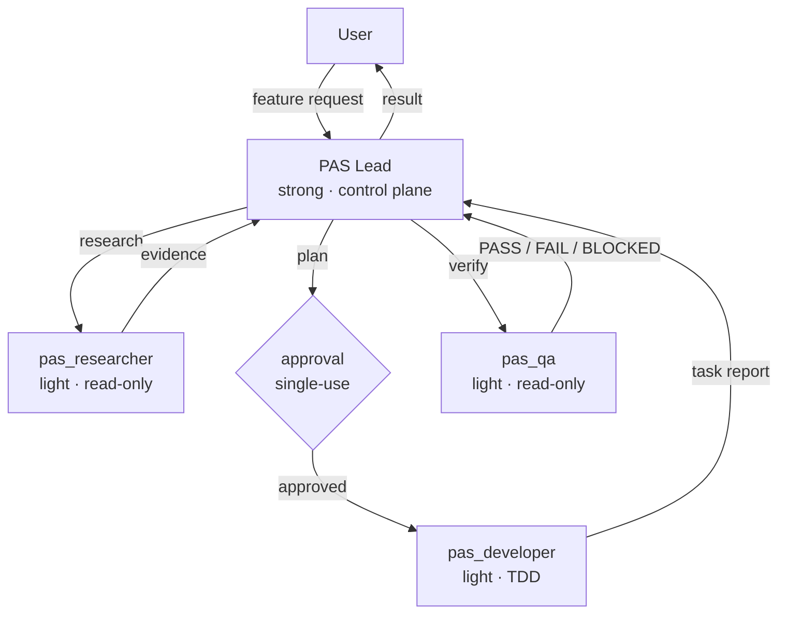

# ✦ Pulsar Agent Squad (PAS)

A lightweight harness for everyday software development.

From new features to ongoing maintenance, PAS coordinates agents to keep work
moving—fast, bounded, and verified.

## From Nova to Pulsar

[Nova Agent Squad](https://github.com/GabrielMartinMoran/nova-agent-squad)
established a multi-platform foundation for explicitly authorized,
contract-driven agent work. Pulsar Agent Squad carries those principles into a
leaner, more atomic workflow: less process overhead, while keeping work
bounded, approved, and verified.

PAS also adds durable project context—living documentation, decision records,
and resumable memory—so agents can support ongoing development and long term maintenance.

## Why PAS

PAS runs a serious engineering workflow without paying for a strong model in
every role. Five properties keep it honest:

- **Strong where it matters.** One strong model runs the control plane:
  planning, approval, and adjudication. Research, implementation, and QA run on
  light workers.
- **Single-use approval gates.** No source change starts without your explicit
  approval, scoped to the task at hand; approval never authorizes later scope
  expansion.
- **Closed contracts and mandatory QA.** Each delegation names its scope,
  exact paths, and assigned skills. QA returns one objective `PASS`, `FAIL`,
  or `BLOCKED` verdict, and the Lead adjudicates it.
- **Numbered, single-writer state.** Features live in `.pas/state/NNNNN-slug/`;
  lifecycle operations go through the installed `pas_toolkit` plugin (`list`,
  `check`, `new`, `archive`), and conflicts block instead of guessing.
- **Living docs and resumable memory.** `docs/` is a map with an ADR trail, and
  Mind checkpoints let a session resume where it stopped.

## Install

You need a POSIX shell, `git`, and [`bun`](https://bun.sh) on your `PATH`. PAS
does not auto-install bun.

```bash
git clone https://github.com/GabrielMartinMoran/pulsar-agent-squad.git
cd pulsar-agent-squad
./install.sh          # default target: opencode
```

`./install.sh` delegates to `pas install --target=opencode`, so the bootstrap
and the CLI share one code path. Other targets use the same flag:

```bash
./install.sh --target=cursor
```

OpenCode is the primary runtime; the full target list is
[`config/platforms.manifest`](config/platforms.manifest).

## Quick start

Verify the install, then point OpenCode at the Lead:

```bash
./pas doctor          # prerequisites, the manifest, and source routes
./pas validate        # agent frontmatter and structure
```

Set `default_agent` in `~/.config/opencode/opencode.json` so the Lead is the
first agent you talk to:

```json
{
  "default_agent": "Pulsar Agent Squad"
}
```

PAS does not set `default_agent` for you. Run `./pas --help` for the full
command surface.

## How it works

Describe a feature; the Lead takes it from there:

1. **Describe** — the Lead clarifies scope and critical assumptions.
2. **Research** — `pas_researcher` gathers evidence; independent questions run
   as one background batch.
3. **Plan** — the Lead writes the plan, tagged Gherkin, and task contracts,
   then stops at the approval boundary.
4. **Approve** — you approve once, scoped to the plan. A changed plan needs a
   new approval.
5. **Implement** — `pas_developer` executes one atomic task at a time,
   with TDD.
6. **Verify** — `pas_qa` runs the checks automatically and returns one
   verdict; the Lead adjudicates and reports.



| Agent            | Model  | Role                                                  | Source                                                                     |
| ---------------- | ------ | ----------------------------------------------------- | -------------------------------------------------------------------------- |
| PAS Lead         | strong | Control plane: plans, approves, adjudicates, persists | [`src/agents/Pulsar Agent Squad.md`](src/agents/Pulsar%20Agent%20Squad.md) |
| `pas_researcher` | light  | Read-only evidence worker                             | [`src/agents/pas_researcher.md`](src/agents/pas_researcher.md)             |
| `pas_developer`  | light  | Bounded TDD implementer, one atomic task              | [`src/agents/pas_developer.md`](src/agents/pas_developer.md)               |
| `pas_qa`         | light  | Read-only verifier, one verdict                       | [`src/agents/pas_qa.md`](src/agents/pas_qa.md)                             |

Permissions are per role and enforced by the runtime, not by prompt text; the
frontmatter of each prompt is the exact profile.

### Model profiles

PAS is designed to operate with lightweight models in its worker roles. Its
robustness comes from the harness—explicit authorization, bounded contracts,
atomic tasks, durable artifacts, and mandatory verification—not from requiring
a strong model at every step.

The following are example routing profiles as of **October 2026**. They
describe reasoning effort within each model family, not universal capability
equivalence across providers:

| Profile | GPT-6 Luna                | DeepSeek V4.1 Flash | Typical PAS use                                                     |
| ------- | ------------------------- | ------------------- | ------------------------------------------------------------------- |
| Light   | `low`                     | `low`               | Default for research, implementation, and QA workers                |
| Medium  | `medium`                  | `high`              | Optional escalation for broad, difficult, or high-risk worker tasks |
| Strong  | `high`, `xhigh`, or `max` | `max`               | PAS Lead: planning, adjudication, and control-plane decisions       |

DeepSeek V4.1 Flash does not expose a `medium` reasoning variant in the current
catalog, so `high` is the suggested medium profile. Revisit these examples when
the provider catalog or available reasoning variants change.

## What makes it different

Contracts, not good intentions, keep the workflow predictable:

- **Single-use approvals.** Approval covers one feature or task set; scope
  expansion requires new approval, and a changed plan stops the line.
- **Test level by contract.** Every Gherkin scenario carries exactly one class
  tag — `@unit`, `@integration`, `@contract`, `@e2e`, or `@manual` — fixing
  its lightest reliable test level. Workers escalate instead of upgrading.
- **Background research, sequential delivery.** Independent research questions
  run in parallel; developer and QA never run concurrently.
- **State as a single-writer store.** `pas_toolkit` owns `list`, `check`,
  `new`, and `archive`; malformed or conflicting state blocks instead of
  guessing.
- **Living docs with an ADR trail.** `docs/` is updated with the change and
  references its sources; accepted ADRs are superseded, never rewritten.
- **Memory that survives sessions.** The Lead persists checkpoints and durable
  decisions through Mind; workers only request `memory_writes`.

Each guarantee maps to a source in this repo: Gherkin behavior contracts in
[`specs/features/product/`](specs/features/product/), agent prompts in
[`src/agents/`](src/agents/), and living docs in [`docs/`](docs/).

## Docs

This README is the map; these are the deeper maps:

- [Architecture](docs/architecture.md) — execution model, permissions,
  distribution pipeline, state, memory, and the ADR index.
- [Domain](docs/domain.md) — entities, business rules, ubiquitous language,
  and domain events.
- [Product](docs/product.md) — what PAS is for, who it serves, feature groups,
  and success metrics.
- [ADRs](docs/adr/) — the decision trail, from numbered state directories to
  the PRD retirement.

## Updating

Stay on your current upstream branch:

```bash
./pas update               # git pull --ff-only
./pas update --rebuild     # pull, then build the opencode target
./pas update --reinstall   # pull, then install the opencode target
./pas update --check       # show the plan, change nothing
```

`./pas update` is a local checkout helper: it refuses to run with uncommitted
changes and does not implement release-based updater logic (no release fetches,
no version pins, no tarballs).

## Project structure

Sources, contracts, and tests live side by side:

```text
pulsar-agent-squad/
├── pas                       # CLI launcher (resolves bun, execs the CLI)
├── install.sh                # Bootstrap installer (default target: opencode)
├── src/
│   ├── agents/               # Agent prompts — the source of truth
│   ├── cli/                  # CLI commands, shared libraries, and templates
│   ├── tools/                # pas_toolkit plugin source
│   └── templates/            # Per-platform distribution templates
├── config/
│   └── platforms.manifest    # Target → source → dist → install mapping
├── docs/                     # Living docs (architecture, domain, product, adr/)
├── specs/features/product/   # Gherkin behavior contracts
├── tests/                    # Unit, integration, and contract tests
└── nova-agent-squad/         # Reference snapshot of Nova Agent Squad (NAS)
```

Edit `src/` and rebuild with `./pas build`; never edit `dist/` or the installed
copy.

## Credits

PAS recommends using [Mind](https://github.com/GabrielMartinMoran/mind) as its memory
backend: structured storage, full-text search, and MCP integration for durable
decisions and session checkpoints.
